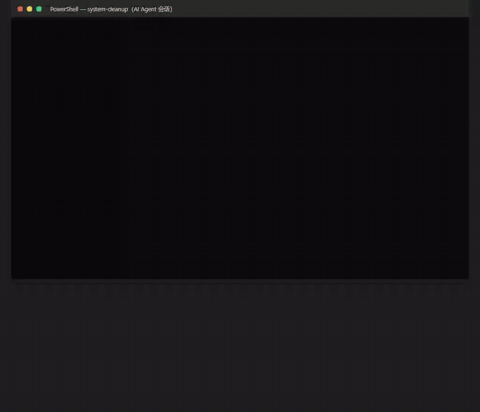

<div align="center">

# system-cleanup

**你说需求，AI 扫描出报告——你点头，它才动手。**

C 盘又红了，但不敢乱删？环境变量一堆，不知道哪个还有用？软件卸载了，垃圾还躺在 AppData 里？

*A confirm-first Windows cleanup skill for AI coding agents.*

[](https://github.com/zl2237/system-cleanup)
[](https://github.com/zl2237/system-cleanup)
[](https://github.com/zl2237/system-cleanup)
[](./LICENSE)
[](https://github.com/zl2237/system-cleanup/pulls)
[](https://gitee.com/zl2237/system-cleanup)

**如果它帮你抢回了 C 盘空间，顺手点个 [⭐ Star](https://github.com/zl2237/system-cleanup) —— 让更多"不敢乱删"的人看到它 🙏**

</div>

---

## 先看演示



一次真实会话（2026-11-25 本机实扫数据回放）：你说一句「C 盘又红了」→ AI **只读扫描**（白名单制，不删任何东西）→ 报告每项标大小/文件数/安全等级 → **你点头它才动手**，谨慎项默认不动 → 执行后汇报释放量，日志与备份可还原。

> 想看一次完整真实清理的全过程数字？见 [一次真实的清理记录（释放 6.28 GB）](./docs/real-cleanup-report.md)。

## 目录

- [先看演示](#先看演示)
- [它能帮你做什么](#它能帮你做什么)
- [它是怎么工作的](#它是怎么工作的)
- [快速开始](#快速开始)
- [为什么敢让它碰你的系统](#为什么敢让它碰你的系统)
- [项目结构](#项目结构)
- [路线图](#路线图)
- [FAQ](#faq)
- [贡献](#贡献)
- [许可证与免责声明](#许可证与免责声明)

## 它能帮你做什么

四大模块，做几件你说了算：

| 你说 | 它做 |
|---|---|
| **"我环境变量好乱"** | 找出 PATH 死条目、失效变量（指向已删除软件/路径的），列表让你勾选清理，删前自动导出 `.reg` 备份 |
| **"这软件卸载了怎么还有残留"** | 交叉比对已安装软件清单 vs AppData / ProgramData 等高发区，找出孤儿目录，按"确定可删 / 拿不准"分档 |
| **"C 盘满了"** | 白名单扫描临时文件、更新缓存、崩溃转储、浏览器缓存与 npm/pip/Maven 等开发者缓存，可定位全盘最大文件，每项标注安全等级，确认后清理并汇报释放量 |
| **"磁盘想重新规划"** | 盘点各盘占用，给出分工方案和迁移清单，确认后用 `robocopy /MOVE` 迁移（数据不丢），同步修正 PATH / 环境变量，最后生成《使用规范》文档 |

四件可以全做，也可以只做其中一件——加载后 AI 会先和你确认范围。

## 它是怎么工作的

```
你说 "C盘满了帮我看看"
        │
        ▼
┌─────────────────────────────────────┐
│  ① 扫描（只读，不删任何东西）          │
│  ② 报告（每项标大小/安全等级/去向）     │
│  ③ 你确认（全删？只删某几项？保留？）   │
│  ④ 执行（自动备份，写日志，可回滚）     │
└─────────────────────────────────────┘
```

没有"一键清理"按钮——**每一次删除都需要你确认。这是设计，不是缺陷。**

## 快速开始

### 前置要求

- Windows 10 / 11
- PowerShell 5.1+（系统自带，**零依赖，无需安装任何东西**）
- 任意支持 Agent Skills 标准（SKILL.md 约定）的 AI 编程助手：**Trae / Claude Code / Cursor / CodeBuddy / ZCode** …
- 修改系统位置（HKLM、系统目录）时的管理员权限——脚本会自动弹 UAC，日常扫描不需要

### 安装

把仓库 clone 到你所用 agent 的 skills 目录，目录名保持 `system-cleanup`：

| Agent | 安装位置 |
|---|---|
| **Trae** | `git clone https://github.com/zl2237/system-cleanup.git "$env:USERPROFILE\.trae-cn\skills\system-cleanup"`（全局），或项目内 `.trae\skills\` |
| **Claude Code** | `git clone https://github.com/zl2237/system-cleanup.git "$env:USERPROFILE\.claude\skills\system-cleanup"`，或项目内 `.claude\skills\` |
| **Cursor / CodeBuddy / ZCode 等** | clone 到该 agent 对应的 skills 目录（参考其官方文档），同样支持 |

也可以[下载 ZIP](https://github.com/zl2237/system-cleanup/archive/refs/heads/master.zip) 解压到上述位置。装完**重启 agent 或新开会话**生效。

### 使用

直接说人话：

```text
帮我清理一下 C 盘
看看哪些环境变量失效了
钉钉卸载了，帮我找找残留
帮我找找 C 盘里最大的文件都是谁
C 盘和 D 盘想重新分工，帮我规划一下
```

AI 会先确认要做哪几件事 → 扫描出报告 → 等你逐项确认 → 才执行。

## 为什么敢让它碰你的系统

- **扫描与执行分离**：4 个扫描脚本只读不删；两个执行器都必须拿到你确认过的 JSON 清单（PlanFile）才会动手
- **白名单制**：只统计、清理公认的可再生位置；`hiberfil.sys`、`pagefile.sys`、`Windows.old` 只报告、永不删
- **注册表先备份**：任何环境变量改动前自动 `reg export`，双击 `.reg` 即可还原
- **迁移不丢数据**：跨盘用 `robocopy /MOVE`（先复制成功、再删源），同卷直接移动
- **占用即跳过**：文件被占用时跳过并记录日志，不强杀进程
- **全程留痕**：报告、备份、日志集中存放在 `桌面\cleanup-report-<日期>\`
- **权限最小化**：仅涉及系统目录 / HKLM 时才弹 UAC

## 项目结构

```
system-cleanup/
├── SKILL.md               # AI 编排指令：四模块流程 + 安全规则
├── scripts/
│   ├── env-scan.ps1       # 扫描失效环境变量 / PATH 死条目（只读）
│   ├── orphan-scan.ps1    # 导出已装软件清单 + 残留高发区（只读）
│   ├── junk-scan.ps1      # 白名单扫描垃圾文件（只读）
│   ├── dev-cache-scan.ps1 # 扫描开发者缓存 npm/Maven/Gradle/Conda/Docker 等（只读）
│   ├── largefile-scan.ps1 # 大文件 Top-N 定位（只读）
│   ├── disk-inventory.ps1 # 盘点磁盘分布（只读）
│   ├── clean-executor.ps1 # 统一清理执行器（需 PlanFile）
│   └── migrate-runner.ps1 # 迁移执行器（同卷移动 / 跨卷 robocopy，需 PlanFile）
└── LICENSE
```

## 路线图

- [x] 失效环境变量扫描与清理
- [x] 已卸载软件残留识别
- [x] 白名单垃圾文件清理
- [x] 磁盘规划与跨盘迁移
- [x] 开发者缓存专项（npm / pnpm / pip / Maven / Gradle / NuGet / Go / Conda / Docker——分级"可删·重建 / 可删·重下 / 官方命令 / 仅报告"）
- [x] 大文件 Top-N 定位（文件级扫描，直击"C 盘红了"的元凶）
- [ ] WinSxS 组件存储瘦身（DISM StartComponentCleanup，可选项）
- [ ] 孤儿服务与计划任务检测（映像路径已失效的残留服务）
- [ ] 系统还原点占用报告（vssadmin，仅报告）

**明确不做**（设计取舍，不是能力缺失）：

- 注册表"深度清理"——收益趋近于零，风险真实存在
- 重复文件删除——误判一次的代价远大于省下的空间
- 启动项/服务"加速优化"——那是另一个赛道
- 自动调整 `hiberfil.sys` / `pagefile.sys`——只报告大小，动不动手由你决定

## FAQ

**Q: 和 CCleaner 这类清理工具有什么区别？**
A: 它不是"一键优化"黑盒。每个删除项都先展示给你（含大小、位置、为什么可删），你确认才执行。判断由 AI 完成（比如区分"钉钉残留"和"还在用的数据目录"），但扣扳机的永远是你。

**Q: 会误删吗？**
A: 扫描是白名单制 + 交叉比对，拿不准的会单独标出来问你，不会混在"可删"里。

**Q: 出问题怎么回滚？**
A: 环境变量有 `.reg` 备份可直接导入；文件删除走回收站逻辑外的目录均有日志记录（Temp/缓存类本身可再生）。

**Q: 不是 Trae 用户，能用吗？**
A: 能。核心是标准 SKILL.md 格式 + 纯 PowerShell 脚本，任何支持 Agent Skills 的客户端加载后即用；脚本本身也可以脱离 agent 手动运行（每个脚本头部有用法注释）。

**Q: 支持 macOS / Linux 吗？**
A: 不支持。脚本全部基于 PowerShell 与 Windows 专属位置（注册表 / AppData / WER），也没有计划。

**Q: 为什么不做注册表清理 / 重复文件删除？**
A: 见上方"明确不做"。本项目只做 AI 能负责任判断、且删错可回滚的清理——少做，但做稳。

## 贡献

欢迎通过 [Issue](https://github.com/zl2237/system-cleanup/issues) / [PR](https://github.com/zl2237/system-cleanup/pulls) 参与：

- 补充垃圾白名单位置（注明来源与安全性依据）
- 报告误判案例（哪个目录被错误标记/保留）
- 验证更多 agent 的安装路径并更新文档

## 许可证与免责声明

[MIT](./LICENSE)

本项目不提供任何形式的担保。它会尽力保证安全——白名单、备份、日志、每步确认——但任何涉及删除的系统工具都无法承诺零风险。请保持两个习惯：

1. 确认前看懂报告里的每一项；看不懂的项，问 AI，或者选保留
2. 重要数据另行备份，尤其是模块 4 迁移前

---

<div align="center">

**如果这个项目帮到了你，点个 [⭐ Star](https://github.com/zl2237/system-cleanup) 再走呗 —— 这是对开源作者最实在的鼓励。**

</div>
